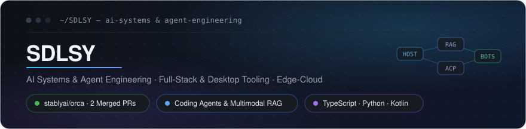

  <picture>
    <source media="(prefers-color-scheme: dark)" srcset="./assets/banner-dark.svg" />
    <source media="(prefers-color-scheme: light)" srcset="./assets/banner-light.svg" />
    
  </picture>

  
  
  

---

### About Me

专注于 **AI Agent 工程化落地**、**多模态知识检索与工作流**，以及**端云协同与桌面效率工具**开发。偏好从第一性原理出发，构建可验证、低抽象负担、贴近真实工程场景的系统。

- **AI & Agent Engineering** — Coding Agent 架构、多模态附件与协议管线（ACP / A2A / MCP）、多模态与图谱 RAG、SOP 合规校验、LLM 评测与可观测性插件
- **Desktop & Developer Tooling** — Orca 核心贡献与扩展插件生态、Electron 桌面应用、Windows 原生托盘效率工具
- **Mobile & Edge-Cloud** — Android / Kotlin 多模块架构、BLE 硬件通信、Next.js + FastAPI 端云协同

---

### Open Source Contributions

#### [`stablyai/orca`](https://github.com/stablyai/orca) — Open-Source Multi-Agent Development IDE

| PR | Status | Summary |
| --- | :---: | --- |
| [**#45539**](https://github.com/stablyai/orca/pull/45539) |  | **Bot 群聊端到端多模态图片附件**（[#45489](https://github.com/stablyai/orca/issues/45489)）：打通桌面剪贴板粘贴/拖拽/选图、`agent-session-attachments` 共享安全准入（`lstat`/`realpath` 防逃逸与配对远程端白名单）、多成员会话 SQLite Claim、`bots.group-attachments.v1` 能力协商、底层 Agent `image-ref` 透传以及桌面/移动端渲染 |
| [**#45600**](https://github.com/stablyai/orca/pull/45600) |  | **Bot 设置页 ACP 模型目录发现与远程宿主机路由修复**：将 Bot 的文件夹工作区键与 `executionHostId` 透传至模型选择器，修复 OMP / OpenCode 2.x 在 Bot Settings 与自动化配置中无法加载模型的问题 |
| [**#46335**](https://github.com/stablyai/orca/pull/46335) |  | **移动端 Bot 对话 Fork 选择器与 `createSupport` 探针修复**（[#46315](https://github.com/stablyai/orca/issues/46315)）：保持 `folder:` 工作区键原样传递（不再错误拼接 `id:` 前缀），并在 terminal-default 宿主机拒绝旧探针时保留 `selector_not_found` 有界重试并继续 `agentSession.create` |

#### [`crewAIInc/crewAI`](https://github.com/crewAIInc/crewAI) — Autonomous Multi-Agent Orchestration Framework

| PR | Status | Summary |
| --- | :---: | --- |
| [**#9638**](https://github.com/crewAIInc/crewAI/pull/9638) |  | **A2A 服务端认证空凭据绕过与时序安全修复**（[#9637](https://github.com/crewAIInc/crewAI/issues/9637)）：为 `SimpleTokenAuth` / `APIKeyServerAuth` 增加空 `token` / `api_key` 校验，将空 `AUTH_TOKEN` 及 `model_construct` 绕过按未授权（HTTP 401）拦截，并将密钥比对替换为 UTF-8 编码的 `hmac.compare_digest` 恒定时间比较 |

#### [`HKUDS/LightRAG`](https://github.com/HKUDS/LightRAG) — Graph-Enhanced Retrieval-Augmented Generation (EMNLP 2025)

| PR | Status | Summary |
| --- | :---: | --- |
| [**#4531**](https://github.com/HKUDS/LightRAG/pull/4531) |  | **知识图谱分块筛选模式校验与 `VECTOR -> WEIGHT` 回退修复**：统一规范化并校验 `kg_chunk_pick_method` / `KG_CHUNK_PICK_METHOD`（改为构造时动态读取并消除大小写导致的缓存键分裂），修复缺失 `query` 或 `chunks_vdb` 时跳过回退而静默返回空列表的缺陷 |

---

### Featured Projects

| Project | Domain | Stack | Highlights |
| --- | --- | --- | --- |
| [**self-use-tools**](https://github.com/SDLSY/self-use-tools) | Orca 插件生态 & 桌面工具 | `TypeScript` `Electron` `C#` `PowerShell` | Orca 扩展插件（Prompt Cache 可观测监控 / PPTX 阅览器 / Gemini 额度面板）、**墨阅**本地 Markdown 桌面查看器、Windows DDC/CI 显示器亮度托盘工具 |
| [**course-coding-agent**](https://github.com/SDLSY/course-coding-agent) | Coding Agent 架构 | `Python` `FSM` `SDD` `TDD` | 无第三方框架的 Python Coding Agent，以显式工具协议、状态机约束与自动化验证闭环把模型输出收敛为可靠工程执行 |
| [**a1-maintenance-assistant**](https://github.com/SDLSY/a1-maintenance-assistant) | 多模态工业 RAG | `Python` `FastAPI` `Multimodal` `KG` | 中国软件杯 A1 赛题多模态设备检修知识检索与作业辅助系统，覆盖图文手册检索、SOP 合规校验、人工修正闭环与评测面板 |
| [**Verspor**](https://github.com/SDLSY/Verspor) | 端云协同健康系统 | `Kotlin` `Android` `BLE` `Next.js` `Supabase` | **长庚环 VesperO** —— 智能戒指端云协同健康辅助系统，覆盖 BLE 采样、睡眠分期模型、AI 问诊、医检报告理解与个性化干预闭环 |

---

### Tech Stack

| Category | Technologies |
| --- | --- |
| **Languages** | `TypeScript` `Python` `Kotlin` `C#` `SQL` `PowerShell` |
| **AI & Agents** | `Coding Agents` `ACP / A2A / MCP` `Multimodal & Graph RAG` `Prompt Caching` `Tool Use` `Evaluation` |
| **Frontend & Desktop** | `React` `Next.js` `Electron` `React Native` `Tailwind CSS` |
| **Backend & Data** | `Node.js` `FastAPI` `SQLite` `Supabase` `Docker` |
| **Mobile & Edge** | `Android (Jetpack / Room / BLE)` `.NET Framework` |
